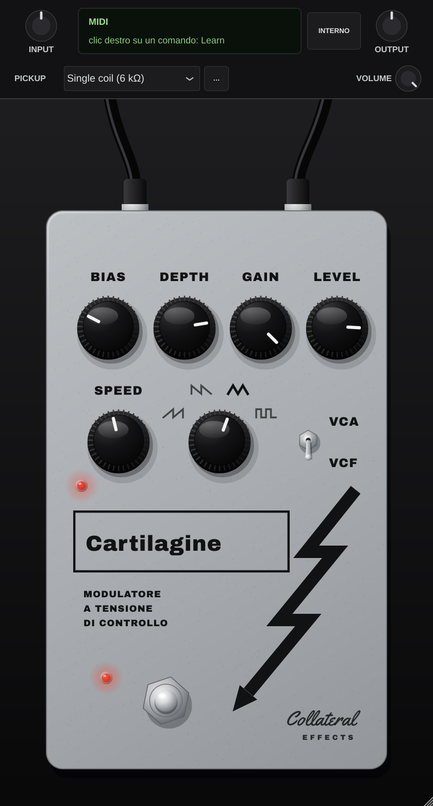

# Collateral Effects CARTILAGINE: emulazione del Gristleizer (VST3 / AU / Standalone)

Plugin in C++17 con JUCE 8. Riferimento: il "Guitar Effects Pedal" di R. Gwinn pubblicato su
*Practical Electronics* (raccolta "Sound Design"), il circuito che Chris Carter costruì per i
Throbbing Gristle e che oggi tutti chiamano **Gristleizer**. *Cartilagine* è la traduzione di
*gristle*. Cinque 741 su ±9 V (due PP3), un JFET 2N3819 come resistenza controllata in tensione,
un LFO con quattro forme d'onda e due trattamenti: filtro passa-banda oppure VCA. Con quattro
forme d'onda e due trattamenti si ottengono gli "otto effetti di base" dell'articolo.



## Comandi

Il pannello segue i Gristleizer autocostruiti di oggi: BIAS e LEVEL, che sull'originale erano
trimmer interni (VR5, VR6), sono manopole, e un pot GAIN prende il posto di R21. Ci sono anche un
LED che segue l'LFO, un deviatore VCA/VCF e un solo interruttore a pedale con il suo LED.

| Comando | Componente | CC predefinito (KeyLab mkII, modalità User) |
|---|---|---|
| SPEED | VR1 10k log: LFO da ~0,1 Hz (a zero) a ~90 Hz, ~9 Hz a metà | 74 (encoder 1) |
| DEPTH | VR4 10k lin: quanta forma d'onda arriva al gate del JFET | 71 (encoder 2) |
| forma d'onda | S1: rampa che sale, rampa che scende, triangolo, quadra | 76 (encoder 3) |
| BIAS | VR5 100k con 220k verso +9 V: la corsa copre solo la zona utile (gate da −3,6 a −0,5 V); il centro della spazzata del filtro e il volume medio del VCA | 77 (encoder 4) |
| GAIN | pot 100k log al posto di R21: guadagno di IC4 da ×1 a ×11 (a fondo corsa = originale) | 93 (encoder 5) |
| LEVEL | VR6 come pot log: volume dell'effetto (predefinito −6 dB) | 18 (encoder 6) |
| VCA / VCF | S2 (deviatore) | 65 (commuta alla pressione) |
| bypass | S3 (a pedale), LED acceso = effetto inserito | 64 (pedale sustain) |
| INPUT / OUTPUT, VOLUME, PICKUP | barra di servizio (non fanno parte del pedale) | — |

**MIDI Learn**: clic destro su un comando, poi *MIDI Learn*, poi muovi un controllo della KeyLab.
Funziona anche per i trimmer, le batterie e il JFET del pannello interno. La mappatura viene salvata nel progetto.
Per i due pedali imposta i pulsanti della KeyLab in modalità *Gate/Momentary* in Arturia MIDI
Control Center.

- **Ableton Live**: plugin sulla traccia audio della chitarra, poi una traccia MIDI con ingresso
  KeyLab e *MIDI To* verso la traccia della chitarra, "CARTILAGINE". In alternativa la mappatura MIDI di Live (Cmd+M).
- **Logic Pro**: l'AU è un normale Audio FX e non riceve i CC. Usa l'assegnazione dei controller
  di Logic (Cmd+K). MIDI Learn interno e CC valgono per VST3 e Standalone.

Come suonarlo (dall'articolo): gli effetti sono ripetitivi, quindi rendono meglio su accordi tenuti e note
lunghe. Rampe che salgono e che scendono hanno effetti opposti sui due trattamenti: la rampa che sale
sul VCA dà un suono che decade, e una rampa veloce dà un effetto "mandolino". La stessa rampa sul filtro fa un
gorgoglio che, rallentando, diventa un "Waa-Waa" ripetuto. Il triangolo molto lento sul filtro va bene anche
sui passaggi veloci.

Livelli reali: 0 dBFS in ingresso corrisponde a 1 V di picco. Il circuito è "caldo": IC4 amplifica 11
volte e IC5 ancora 10 (VCA) o 23,5 (centro del filtro), quindi con la chitarra a pieno volume i 741
saturano. È il suono dell'originale. IC5 satura a ±8 V: alzando INPUT o GAIN aumenta la
distorsione, non il volume; per il volume usa LEVEL o OUTPUT. Con LEVEL a −6 dB l'effetto può
arrivare a +12 dBFS di picco.

**Applicazione autonoma**: JUCE la avvia con l'ingresso audio silenziato (contro il feedback);
CARTILAGINE lo riattiva da sé all'apertura. Se senti solo la chitarra diretta, controlla in
*Options → Audio/MIDI Settings* l'ingresso giusto e che "Mute audio input" sia spento, e disattiva
il monitoraggio diretto della scheda audio.

## Interno (pulsante INTERNO)

- **Oscilloscopio** sulla forma d'onda che arriva a DEPTH (cima di VR4), con la frequenza
  dell'LFO misurata. L'articolo consiglia proprio un oscilloscopio per la taratura.
- **Gate del JFET e spazzata misurati** sull'ultimo secondo e mezzo: in FILTER la frequenza centrale minima e
  massima, in ENVELOPE il guadagno del VCA.
- **VR2 TRIANGLE SHAPING, VR3 TRIANGLE OFFSET**: i due trimmer rimasti dentro.
  Maiusc + trascina per la regolazione fine, doppio clic per la taratura originale.
- **Batterie** (6 – 9,6 V): cambiano la velocità dell'LFO, le soglie del trigger, la polarizzazione
  e la saturazione dei 741.
- **2N3819 Vp** (−1 … −6 V): il datasheet ammette da −0,5 a −8 V. Cambiando JFET si sposta tutta la
  spazzata e BIAS va ritoccato, come sul pedale vero. IDSS segue Vp e la resistenza minima del canale resta ~128 Ω.
- **TARATURA ORIGINALE** riporta trimmer, BIAS, GAIN, LEVEL, batterie e JFET ai valori di fabbrica.

### La taratura di fabbrica (procedura "Setting up" dell'articolo, eseguita sul modello)

| Trimmer | Criterio | Valore |
|---|---|---|
| VR2 | forma d'onda su "triangolo", miglior triangolo: estremi uguali, quindi nessun salto quando la rampa torna indietro | 64,7 % |
| VR3 | 0 V di media all'uscita di IC3 | 27,8 % |
| VR5 / BIAS | FILTER, DEPTH al massimo: spazzata piena e regolare, da ~340 Hz (JFET interdetto) a ~2,2 kHz | 11,5 % del pot originale = BIAS a 2,7 |
| VR6 / LEVEL | a orecchio, con la chitarra (la taratura "stesso volume del diretto" usciva troppo bassa) | −6 dB |

`tests/circuit_test.cpp` rifà la taratura di VR2 e VR3 e controlla che coincida con quella del plugin.

## I Gristleizer autocostruiti di oggi

Le versioni moderne (Endangered Audio Research, Emmerich "Gristle Throbber" e molti pedali fatti in
casa) mantengono il circuito di Gwinn e cambiano il pannello in modo molto simile:
- **BIAS e LEVEL fuori**: i due trimmer che contano davvero mentre si suona. BIAS sposta il punto di
  lavoro del JFET, e quindi la zona della spazzata; LEVEL compensa un circuito molto caldo.
- **GAIN** (in alcune versioni): regola quanto IC4 spinge il JFET e IC5, quindi la saturazione.
- **LED di velocità**, pilotato dalla forma d'onda: indispensabile con l'LFO lento.
- **VCA/VCF su deviatore** e un solo pedale di bypass con LED, al posto dei due pedali.
- **SPEED** a volte si chiama **FREQ**; il selettore resta a 4 posizioni.
- Alimentazione: quasi sempre un 9 V unico (con pompa di carica o massa virtuale) al posto delle
  due PP3, e spesso TL072 al posto dei 741. In questo plugin restano i 741 dell'articolo.

## Il circuito, stadio per stadio

- **LFO**: IC1 integra la corrente che arriva dal cursore di VR1 (tra 0 e −9 V) attraverso R1 56k.
  IC2 è un trigger di Schmitt (R3 10k / R4 47k, soglie ±1,7 V) e, quando scatta, D1 (OA47) con R2 470 Ω
  scarica C1 in circa 0,1 ms. Il risultato è una rampa da 3,4 Vpp.
- **Forme d'onda (S1)**: rampa diretta da IC1, IC3 invertitore (rampa che scende), IC3 comparatore
  (quadra ±8 V ridotta da R14 sul pot) e il triangolo. Per il triangolo TR1 (BC187) si comporta da
  amplificatore invertente finché è in zona attiva e segue la rampa quando satura; IC3 lo amplifica
  e VR3 ne toglie la continua.
- **CV**: R15/C5 e R16/C6 smussano gli spigoli (meno "breakthrough" del comando in uscita), VR5 con R17
  polarizza. Il gate del 2N3819 riceve il CV attraverso D2 e R18 1M verso +9 V.
- **Audio**: C7/R19 (47 kΩ d'ingresso), IC4 con guadagno 11, R22 10k sul drain del JFET.
  In **FILTER** C8, C9 e R24 formano un passa-banda a retroazione multipla: la resistenza del JFET in
  parallelo a R22 sposta la frequenza (f0 = 1 / (2π·C·√((R22‖Rds)·R24))) a banda costante di circa
  100 Hz, per cui il Q sale con la frequenza (da 3,4 a oltre 20). In **ENVELOPE** R23/R24 fanno di IC5 un
  amplificatore invertente con guadagno 10, e il partitore R22 + JFET diventa un VCA.

## Il modello

- **Nucleo**: analisi nodale con Newton-Raphson su drain, ingresso − di IC5, gate e nodo CV. Il nodo di
  C5 è lineare e viene eliminato, lo stato di IC5 è funzione esplicita della tensione d'ingresso.
  Ricerca lineare sul residuo, perché con lo stadio d'ingresso del 741 saturo Newton puro può
  rimbalzare. Condensatori col trapezio. Media di 1,7 iterazioni per campione, nessun campione
  non convergente nei test.
- **2N3819**: Shichman-Hodges simmetrico (triodo e saturazione in tutte e due le polarità, parametri
  della libreria SPICE: VTO −3 V, β 1,304 mA/V²), giunzioni gate-source e gate-drain, Cgs e Cgd. Il gate
  riceve solo i 9 µA di R18: con segnali forti la giunzione gate-drain lo trascina insieme al drain,
  come nel circuito vero.
- **741**: IC5 con prodotto guadagno-banda di 1 MHz, slew rate di 0,5 V/µs dallo stadio d'ingresso (tanh),
  saturazione morbida a ±(V − 1). IC4 con polo a GBW/11, slew rate e saturazione. IC1, IC2 e IC3
  con slew rate e saturazione.
- **TR1**: Ebers-Moll completo, risolto a ogni campione. Il triangolo, con i suoi spigoli e la sua
  asimmetria, viene fuori dal transistor e non da una formula.
- **D1, D2 (OA47)**: diodi al germanio con la loro corrente inversa. Con SPEED a zero l'LFO non si
  ferma del tutto: lo fanno girare piano la perdita di D1 e la polarizzazione di IC1.
- **Ingresso**: pick-up (R, L, C), potenziometri della chitarra e cavo davanti ai 47 kΩ del pedale, con
  la correzione della DI registrata a 1 MΩ, come in FTG-1. Le chitarre salvate in FTG-1 o FYN-2
  compaiono in "Le mie chitarre".
- **Frequenza interna**: circa 384 kHz (8x a 44,1/48 kHz, 4x a 88,2/96, 2x a 176,4/192).
  È il minimo a cui il modello di IC5 resta affidabile: a 192 kHz, con il filtro saturo, la soluzione
  si stacca da quella di riferimento a 768 kHz. LFO e forme d'onda girano a ~96 kHz con il CV interpolato.
  Latenza 6 campioni. CPU: circa 9-12% di un core sul server Linux di sviluppo (lento).
  Su un Mac Apple Silicon il carico è molto più basso.
  Con S3 su OUT, dopo la dissolvenza il circuito si ferma e non consuma CPU.

**Limiti noti e scelte**:
- L'articolo avverte che, con VR5 troppo avanti, il filtro "entra in oscillazione". Con un 741 a polo
  dominante il passa-banda resta stabile anche con il JFET tutto acceso (verificato anche
  analiticamente). La causa più probabile è il secondo polo del 741 con il carico capacitivo di C8,
  a centinaia di kHz, che questa simulazione non riproduce. Per questo VR5 è tarato sulla spazzata
  piena, senza tratti fermi. Il pannello interno avvisa quando il gate arriva al limite.
- Il triangolo esce asimmetrico (circa 64/36): TR1 in saturazione "guadagna" circa la metà che in zona
  attiva. Con il criterio degli estremi uguali (nessun salto) è il miglior triangolo che il circuito dà.
- Valori tipici per i semiconduttori (BC187 β 150, OA47, 2N3819 di libreria): gli esemplari veri
  variavano molto. Per il JFET c'è il comando Vp.
- Il cavo verso l'amplificatore non è simulato: l'uscita di VR6 ha bassa impedenza alla taratura.
- In ENVELOPE e in FILTER l'uscita è invertita di polarità rispetto all'ingresso (IC5 è invertente),
  come sull'originale.

## Scaricare la versione per Mac (Apple Silicon e Intel)

Ogni modifica su `main` viene compilata da GitHub Actions su macOS (universal binary) e
verificata con `pluginval` (VST3 e AU, livello 7) e `auval`.

1. **Actions → Build macOS**, poi l'ultima esecuzione riuscita, poi scarica l'artefatto **CARTILAGINE-macOS**.
   Alzando la versione in `CMakeLists.txt` la build compare anche in **Releases**.
2. Estrai lo zip (contiene `CARTILAGINE-macOS.zip`: estrai anche quello).
3. Terminale: `xattr -dr com.apple.quarantine `, poi trascina la cartella `CARTILAGINE`, poi doppio clic su
   **Installa CARTILAGINE.command** (password di amministratore).
4. Riavvia la DAW (Logic: *Plug-in Manager → Reimposta e riscansiona* se non compare).

## Compilazione

CMake ≥ 3.22. JUCE 8.0.4 viene scaricato da solo (oppure `-DJUCE_DIR=/percorso/JUCE`).

```
cmake -B build -G Xcode            # macOS
cmake --build build --config Release
```

I test girano tutti su GitHub:
- `circuit_test`: LFO, taratura, filtro e VCA confrontati con le formule, convergenza, CPU.
- `click_test`: comandi, trimmer, batterie e JFET mossi mentre si suona, commutazioni di S1 e S2.
- `processor_test`, con `-DCRT_BUILD_PROCESSOR_TEST=ON`: blocchi della DAW, CC, interruttori, MIDI Learn, stato.

`-DCRT_BUILD_SNAPSHOT=ON` compila lo strumento che rigenera `resources/icon.png` e gli screenshot.

## Grafica e caratteri

Interfaccia ispirata ai Gristleizer autocostruiti: scatola grigio chiaro verniciata a polvere,
serigrafia nera, manopole nere zigrinate, LED rossi, deviatore VCA/VCF. Nome, scritte e la
"scintilla" (un dente di sega spezzato, cioè la rampa dell'LFO) sono propri: il logo e lo slogan dei
Throbbing Gristle non sono riprodotti. Caratteri: Archivo Black (SIL OFL), Yellowtail (Apache 2.0),
licenze in `resources/fonts/`. Uso personale e non commerciale.
